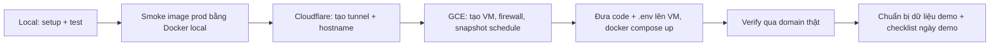

# Runbook: chạy, kiểm thử, triển khai G-UNIFORM Slice 1

Phạm vi: chạy local, kiểm thử (tự động + thủ công), triển khai lên GCE + Cloudflare Tunnel, checklist demo. Nguồn: `docs/specs/SPEC.md` (mục Commands, Deployment, Success Criteria), `README.md`.

Trạng thái đã kiểm chứng trên máy dev (2026-10-18): `pytest` 112 passed, `ruff`, `mypy` sạch, `pnpm test` 16 passed, `pnpm lint`, `pnpm typecheck`, `pnpm build` sạch. Image production build được; trong container: `/api/healthz` 200, SPA phục vụ ở `/` và `/login`, 401 cho `/api/students|stats|export|events` khi chưa đăng nhập, 404 cho token sai, đăng nhập OK, `/api/events` trả `text/event-stream` và `: ping` sau 15 s. **Chưa kiểm chứng:** phần GCE và Cloudflare (cần tài khoản của bạn), các mục có nhãn `[CHƯA CHẠY]`.

## 0. Tổng quan



| Thành phần | Chạy ở | Port |
|---|---|---|
| Postgres dev | Docker (`db`) | `127.0.0.1:55432` |
| Postgres test | Docker (`db-test`, tmpfs) | `127.0.0.1:55433` |
| Backend dev | `uv run uvicorn` | `127.0.0.1:8000` |
| Frontend dev | `pnpm dev` | `127.0.0.1:5173` (proxy `/api` → 8000) |
| Prod | Docker Compose: `db`, `app`, `cloudflared` | không mở port ra internet |

## 1. Setup local

### Makefile

Lệnh dùng hằng ngày nằm trong `Makefile` ở root (`make help` để xem). Phần còn lại của runbook dùng các target này và chỉ giải thích lệnh gốc khi cần.

| Target | Việc | Chạy ở |
|---|---|---|
| `make setup` | Tạo `backend/.env.local` nếu chưa có (hỏi mật khẩu admin), bật DB dev + test, cài dependency, migrate, seed. Chạy lại được sau khi sửa seed | local |
| `make seed-demo` | Nạp dữ liệu mẫu đa dạng vào DB dev (`backend/scripts/seed_demo.py`) | local |
| `make dev` | Backend `:8000` + frontend `:5173` | local |
| `make test` | pytest + vitest | local |
| `make lint` | ruff, mypy, eslint, tsc | local |
| `make smoke` | Build image production, chạy smoke trong container, tự dọn | local |
| `make hash` | In argon2 hash cho `ADMIN_PASSWORD_HASH` | local |
| `make up` | `docker compose -f docker-compose.yml up -d --build` | VM |
| `make logs` | Theo dõi log `app` | VM |

Không có target xóa dữ liệu: lệnh phá hủy cố ý không đặt trong Makefile.

### 1.1 Yêu cầu

`docker` (Compose v2), `uv`, `node` 22, `pnpm`. Python 3.12 do `uv` tự quản (`backend/.python-version`).

### 1.2 Lần đầu

```bash
make setup
```

`docker-compose.override.yml` tự được nạp ở local: publish port DB và mặc định mật khẩu DB là `guniform_dev`. Mật khẩu Postgres chỉ áp dụng khi volume `pgdata` được tạo lần đầu. Nếu đã init với mật khẩu khác thì xem 1.4.

`make setup` tạo `backend/.env.local` (gitignored) với `COOKIE_SECURE=false` (bắt buộc khi chạy HTTP, Safari không lưu cookie `Secure` trên HTTP) và `PUBLIC_BASE_URL=http://127.0.0.1:5173`. Mật khẩu admin được hỏi hai lần, không echo.

### 1.3 Chạy hằng ngày

```bash
make dev
```

Mở `http://127.0.0.1:5173`, đăng nhập `admin` + mật khẩu đã hash. `make setup` chạy lại được bất kỳ lúc nào (idempotent: dùng khi sửa `backend/config/catalog.seed.yaml`). Cần dữ liệu để xem dashboard, danh sách, export: `make seed-demo`.

`make seed-demo` đi qua đúng handler của app nên audit log, `portal_token`, `suggested_size_label` đều được sinh như khi nhập tay. Dữ liệu mang tính xác định (cùng seed ngẫu nhiên), tên và SĐT tổng hợp, gồm: 2 trường, 9 lớp khối 1–9, 59 học sinh với 148 lần thử đủ chật/vừa/rộng và ghi chú, 12 học sinh có lựa chọn của phụ huynh, 1 học sinh xóa mềm, cùng các ca biên (120 cm/18 kg, 95 cm/12 kg ngoài bảng size, 190 cm/90 kg, chưa thử áo, chỉ thử gile, nhiều cỡ vừa, SĐT dạng `+84`). Script bỏ qua nếu DB đã có học sinh và từ chối chạy khi `DATABASE_URL` không phải `127.0.0.1`/`localhost`. Muốn nạp lại: reset DB dev theo 1.4 rồi `make seed-demo`.

Thử QR trên điện thoại thật trong LAN: `pnpm dev --host`, đặt `PUBLIC_BASE_URL=http://<IP-LAN-máy-dev>:5173` trong `.env.local`, restart backend. Link QR chứa `PUBLIC_BASE_URL`, nên `127.0.0.1` không mở được từ điện thoại.

### 1.4 Reset dữ liệu dev

Chỉ dùng ở máy dev. Lệnh `down -v` xóa volume `pgdata`; tuyệt đối không chạy trên VM (xem mục 5).

```bash
docker compose down -v && make setup
```

### 1.5 Lỗi hay gặp local

| Triệu chứng | Nguyên nhân | Xử lý |
|---|---|---|
| Login luôn "Sai tên đăng nhập hoặc mật khẩu" dù đúng mật khẩu | Có process khác giữ `127.0.0.1:8000` (uvicorn cũ). Docker prod stack cũng publish `127.0.0.1:8000`, hai bên cùng bind được và request đi nhầm | `lsof -nP -iTCP:8000 -sTCP:LISTEN`, tắt process cũ |
| `pytest` lỗi connect `55433` | `db-test` chưa chạy | `docker compose up -d db-test` |
| Login 200 nhưng reload là về `/login` | `COOKIE_SECURE=true` trên HTTP | Đặt `false` trong `.env.local` |
| `429 rate_limited` khi login | 5 lần/phút/IP | Đợi 60 s hoặc restart backend (limiter nằm trong bộ nhớ) |

## 2. Kiểm thử

### 2.1 Tự động (Success Criteria #12)

| Phạm vi | Lệnh (cwd) | Kỳ vọng |
|---|---|---|
| Backend test | `uv run pytest -q` (`backend/`) | 112 passed. Cần `db-test` chạy. Fixture tự `DROP SCHEMA public` trên DB test, không đụng DB dev |
| Lint, format | `uv run ruff check . && uv run ruff format --check .` | sạch |
| Types | `uv run mypy app` | `Success: no issues` |
| Frontend test | `pnpm test` (`frontend/`) | 16 passed |
| Frontend lint | `pnpm lint` | sạch |
| Frontend types | `pnpm typecheck` | sạch |
| Build SPA | `pnpm build` | `dist/` được tạo |

Chạy `make lint test` trước mỗi lần deploy: tất cả phải xanh. `pnpm build` được chạy trong `make smoke` (qua Dockerfile).

### 2.2 Smoke image production ở local (trước khi lên GCE)

```bash
make smoke
```

Dùng project `gsmoke` riêng, `-f docker-compose.yml` (bỏ override), không chạy `cloudflared`, mật khẩu admin tạm `smoke-pass-123`. Script `scripts/smoke.py` chạy **bên trong container** `app` nên không bị process dev trên `127.0.0.1:8000` làm nhiễu. Kiểm tra: `healthz` 200, SPA ở `/` và `/login`, 401 cho bốn route admin khi chưa đăng nhập, 404 cho token sai, login OK, `/api/events` trả `text/event-stream`. Kỳ vọng dòng cuối `smoke passed`; stack và `.env.smoke` được xóa dù pass hay fail.

Lưu ý: stack smoke publish `127.0.0.1:8000`. Trên Linux sẽ lỗi nếu dev server đang giữ port đó; tắt dev server trước.

### 2.3 Smoke thủ công qua UI (local hoặc domain thật)

Dùng cho cả local và sau khi deploy. Tạo trước một trường và một lớp ngay trong form.

| # | Hành động | Kỳ vọng | Criteria |
|---|---|---|---|
| 1 | Nhập 140 cm / 32 kg | Blazer và gile gợi ý Cỡ 4 | 13 |
| 2 | Nhập 120 cm / 18 kg | Gợi ý Cỡ 2 (chiều cao lớn hơn) | 13 |
| 3 | Nhập 95 cm / 12 kg | "Chưa có gợi ý cho số đo này" | 13 |
| 4 | Đổi tay cỡ ở một dòng, rồi đổi số đo | Cỡ đã đổi tay giữ nguyên | 13 |
| 5 | Lưu học sinh có 2–3 lần thử | Màn hình xác nhận có QR và link | 3 |
| 6 | Lưu một học sinh với một trial có cỡ không thuộc sản phẩm (chỉnh qua API) | 422, không có học sinh dở dang trong danh sách | 4 |
| 7 | Tạo trùng (cùng trường, lớp, tên, dob) | 409 duplicate | spec Data Model |
| 8 | Sửa rồi xóa mềm một học sinh | Biến mất khỏi danh sách, vẫn còn trong DB (`deleted_at`) | 5 |
| 9 | Mở dashboard ở máy B, nhập học sinh ở máy A | Máy B cập nhật trong ≤ 2 s | 7 |
| 10 | Máy B tắt wifi 10 s rồi bật lại | Dashboard tự cập nhật đúng | 7 |
| 11 | Quét QR bằng điện thoại | Thấy đúng học sinh, chọn cỡ, xác nhận; lựa chọn hiện ở chi tiết admin | 8 |
| 12 | Export `students`, `trials` CSV/XLSX | Mở bằng Excel, tiếng Việt đúng dấu, `trials` có `suggested_size_label` | 9 |
| 13 | Dashboard: tổng học sinh, tổng lần thử | Khớp số đã nhập | 3 |

### 2.4 Kiểm tra API, DB bằng lệnh

Chặn truy cập (Criteria #2), thay `$BASE` bằng `http://127.0.0.1:8000` hoặc domain thật:

```bash
for p in students stats/overview export/students.csv events; do curl -s -o /dev/null -w "$p %{http_code}\n" $BASE/api/$p; done
curl -s -o /dev/null -w "public-bad-token %{http_code}\n" $BASE/api/public/students/nope
```

Kỳ vọng: bốn dòng đầu `401`, dòng cuối `404`.

Audit append-only (Criteria #5), chạy **sau khi** đã sửa hoặc xóa ít nhất một học sinh (bảng rỗng thì lệnh trả `UPDATE 0` và không chứng minh gì):

```bash
docker compose exec db psql -U guniform -d guniform -c "SELECT action, entity FROM audit_logs ORDER BY at DESC LIMIT 5"
docker compose exec db psql -U guniform -d guniform -c "UPDATE audit_logs SET actor='x'"
docker compose exec db psql -U guniform -d guniform -c "DELETE FROM audit_logs"
```

Kỳ vọng: hai lệnh cuối báo lỗi từ trigger. Trigger cũng có test tự động trong `backend/tests`.

Log không chứa PII (Criteria #11), sau khi nhập vài học sinh có SĐT:

```bash
docker compose logs app | grep -E "0[0-9]{9}|@" || echo "clean"
docker compose logs app | grep -F "<một tên học sinh đã nhập>" || echo "clean"
```

Kỳ vọng: `clean` cả hai.

## 3. Triển khai: Cloudflare

Thực hiện một lần. Domain `samocdigital.com` đã ở Cloudflare (giả định #2 của spec).

1. Cloudflare dashboard → **Zero Trust** → **Networks** → **Tunnels** → **Create a tunnel** → loại **Cloudflared** → đặt tên `guniform`.
2. Ở bước cài đặt, **chỉ copy token** (chuỗi dài sau `--token` / `tunnel run`). Không chạy lệnh cài ở đó vì `cloudflared` chạy trong compose.
3. Tab **Public Hostname** (hoặc **Published application routes**) → Add:
   - Subdomain `giabaco`, Domain `samocdigital.com`, Path để trống
   - Service type `HTTP`, URL `app:8000` (hostname `app` là tên service trong compose network)
4. Lưu. Cloudflare tự tạo bản ghi DNS CNAME `giabaco` trỏ vào tunnel. Nếu báo bản ghi `giabaco` đã tồn tại thì xóa bản ghi cũ ở **DNS → Records** rồi thêm lại hostname.
5. Giữ token cho bước `.env`. Token là secret: không commit, không dán vào chat, rotate trong dashboard nếu lộ.
6. Không bật Cloudflare Access (đã chốt trong spec).

Tunnel ở trạng thái **Inactive/Down** cho đến khi container `cloudflared` chạy (mục 4.5).

## 4. Triển khai: GCE

Đặt biến một lần cho cả phiên shell. Máy bạn đang trỏ mặc định vào project `vph-legacy` (project khác có nhiều VM). Đặt `PROJECT` rõ ràng, không dựa vào default.

```bash
export PROJECT=<gcp-project-id-dành-cho-demo>
export ZONE=asia-southeast1-b
export REGION=asia-southeast1
export VM=guniform-demo
gcloud config set project $PROJECT
```

### 4.1 Tạo VM, firewall, snapshot schedule

```bash
gcloud compute instances create $VM --zone=$ZONE --machine-type=e2-medium \
  --image-family=ubuntu-2404-lts-amd64 --image-project=ubuntu-os-cloud \
  --boot-disk-size=30GB --boot-disk-type=pd-balanced

gcloud compute firewall-rules create guniform-allow-iap-ssh --network=default \
  --direction=INGRESS --allow=tcp:22 --source-ranges=35.235.240.0/20

gcloud compute resource-policies create snapshot-schedule guniform-hourly \
  --region=$REGION --hourly-schedule=1 --start-time=00:00 \
  --max-retention-days=3 --on-source-disk-delete=keep-auto-snapshots

gcloud compute disks add-resource-policies $VM --zone=$ZONE --resource-policies=guniform-hourly
```

Ghi chú:
- `e2-medium` (4 GB) để `docker build` không hết RAM. Đừng hạ xuống `e2-small` trừ khi thêm swap.
- Image Ubuntu amd64. Build image **trên VM**, không build ở Mac M1 rồi đẩy lên (khác kiến trúc).
- Không tạo rule mở 80/443. `cloudflared` chỉ cần egress. VM giữ external IP ephemeral để có egress. Rule `default-allow-ssh` mặc định của VPC `default` cho SSH từ `0.0.0.0/0`: xóa hoặc giới hạn `source-ranges` về IP của bạn sau khi xác nhận SSH qua IAP chạy được (`gcloud compute firewall-rules list`).
- `--start-time` tính theo UTC.
- Disk boot cùng tên với VM nên lệnh `add-resource-policies $VM` gắn policy đúng disk.

Kiểm tra snapshot chạy (sau ≥ 1 giờ): `gcloud compute snapshots list` thấy snapshot mới.

### 4.2 Cài Docker trên VM

```bash
gcloud compute ssh $VM --zone=$ZONE --tunnel-through-iap
```

Trên VM:

```bash
curl -fsSL https://get.docker.com | sudo sh && sudo apt-get install -y make
sudo usermod -aG docker $USER
exit
```

SSH lại để nhóm `docker` có hiệu lực, rồi `docker compose version` để kiểm tra. Docker tự khởi động cùng OS, các service dùng `restart: unless-stopped`.

### 4.3 Chuẩn bị `.env` production (ở máy local)

```bash
cp .env.example .env
```

| Biến | Giá trị |
|---|---|
| `POSTGRES_PASSWORD` | `openssl rand -hex 24` |
| `SESSION_SECRET` | `openssl rand -hex 32` |
| `ADMIN_USERNAME` | `admin` |
| `ADMIN_PASSWORD_HASH` | output của `make hash`, **bọc dấu nháy đơn** (hoặc escape mọi `$` thành `$$`) |
| `TUNNEL_TOKEN` | token ở mục 3 |
| `PUBLIC_BASE_URL` | `https://giabaco.samocdigital.com` |
| `COOKIE_SECURE` | `true` |

Dòng `DATABASE_URL` trong `.env.example` không được compose dùng (service `app` tự dựng URL từ `POSTGRES_PASSWORD`), để nguyên.

Mật khẩu admin mạnh, khác mật khẩu dev. Chia sẻ qua kênh an toàn.

### 4.4 Đưa code và `.env` lên VM

Repo chưa có commit nào và chưa có remote, nên dùng tarball. Loại `docker-compose.override.yml` để không dính port DB và mật khẩu mặc định (README cũng cảnh báo điều này).

```bash
COPYFILE_DISABLE=1 tar czf /tmp/guniform.tgz \
  --exclude=node_modules --exclude=.venv --exclude=dist --exclude=__pycache__ \
  --exclude='.*_cache' --exclude=.env.local \
  Dockerfile Makefile docker-compose.yml .dockerignore .env.example backend frontend

gcloud compute scp /tmp/guniform.tgz .env $VM:~ --zone=$ZONE --tunnel-through-iap
gcloud compute ssh $VM --zone=$ZONE --tunnel-through-iap --command \
  'mkdir -p ~/guniform && tar xzf ~/guniform.tgz -C ~/guniform && mv ~/.env ~/guniform/.env && chmod 600 ~/guniform/.env && rm ~/guniform.tgz'
```

Nếu sau này có private Git remote thì thay bằng `git clone` + `git pull` (ngắn hơn, có lịch sử để rollback).

### 4.5 Khởi chạy

Trên VM, `cd ~/guniform`:

```bash
make up
make logs
docker compose -f docker-compose.yml ps
```

`make up` luôn truyền `-f docker-compose.yml`; với lệnh compose gõ tay trên VM cũng phải truyền như vậy. Container `app` tự chạy `alembic upgrade head` + seed rồi `uvicorn --workers 1` (bắt buộc 1 worker vì SSE bus nằm trong bộ nhớ). Lần build đầu mất vài phút.

Kỳ vọng: `db` healthy, `app` Up, `cloudflared` Up, log app có `seeded 2 products` và `Application startup complete`; trong Zero Trust tunnel chuyển **Healthy**.

### 4.6 Verify qua domain thật (Criteria #1, #2, #7)

Từ máy local:

```bash
export BASE=https://giabaco.samocdigital.com
curl -s -D - -o /dev/null $BASE/ | grep -iE "^(HTTP|server|cf-ray)"
curl -s $BASE/api/healthz
```

Kỳ vọng: HTTP/2 200, `server: cloudflare`, có `cf-ray`, healthz `ok`. Dùng GET (`-D -`), không dùng `curl -I`: route SPA chỉ đăng ký GET nên HEAD `/` trả 404. Uptime check (nếu thêm) cũng trỏ vào `GET /api/healthz`. Sau đó chạy mục 2.4 (401/404) với `BASE` này.

SSE không bị đệm (cần cookie session):

```bash
curl -s -c /tmp/cj -X POST $BASE/api/auth/login -H 'content-type: application/json' \
  -d '{"username":"admin","password":"<mật khẩu>"}'
curl -sN -b /tmp/cj $BASE/api/events
```

Kỳ vọng: dòng `: ping` xuất hiện đều mỗi ~15 s ngay trên terminal, không dồn cục. Ctrl-C để dừng, `rm /tmp/cj`.

DB không lộ port: trên VM `docker compose -f docker-compose.yml ps` cột Ports của `db` chỉ có `5432/tcp` (không có `->`), `app` là `127.0.0.1:8000->8000`.

Sau đó chạy toàn bộ bảng 2.3 trên domain thật, đặc biệt #9, #10, #11 (cần điện thoại thật qua 4G, không cùng wifi).

### 4.7 Kiểm chứng restart và backup (Criteria #4, #10)

Trên VM:

```bash
docker compose -f docker-compose.yml restart
docker compose -f docker-compose.yml down && docker compose -f docker-compose.yml up -d
```

Đếm lại số học sinh trước và sau (dashboard hoặc `psql -Atc "select count(*) from students where deleted_at is null"`) phải bằng nhau. **Không** dùng `down -v` (xóa `pgdata`).

Backup: `[CHƯA CHẠY]` thử phục hồi một lần như spec yêu cầu, tạo disk từ snapshot mới nhất, gắn vào VM tạm, khởi động Postgres, đối chiếu số bản ghi:

```bash
gcloud compute snapshots list --sort-by=~creationTimestamp --limit=3
gcloud compute disks create guniform-restore-test --zone=$ZONE --source-snapshot=<tên-snapshot>
```

Xóa disk và VM tạm sau khi thử.

## 5. Dữ liệu demo

Trên máy dev dùng `make seed-demo` (mục 1.3). Trên VM không chạy script này (nó từ chối DB không phải local); dữ liệu demo trên domain thật nhập qua UI:

| Cách | Khi dùng |
|---|---|
| Nhập tay 5 học sinh theo bảng 2.3 (#1–#5) cộng một vài học sinh khác nhau về cỡ | Demo ngắn, đủ cho dashboard và phụ huynh |
| Nhập 100 học sinh qua UI (Criteria #3) | Kiểm thử tải thao tác thật, tốn công |

Dữ liệu demo nằm cùng DB với dữ liệu thật. Xóa dữ liệu demo bằng `down -v` là **ngoại lệ có chủ đích**, vì nó xóa luôn `students`, `fitting_trials`, `audit_logs` (trái quy tắc không hard delete của dự án) và cùng họ lệnh với kiểm tra restart ở 4.7. Chỉ làm khi đã qua đủ ba chốt:

1. DB chỉ chứa dữ liệu demo: trên VM `docker compose -f docker-compose.yml exec db psql -U guniform -d guniform -Atc "select count(*), min(measured_at), max(measured_at) from students"` khớp với những gì bạn đã nhập cho demo.
2. Đã có snapshot ngay trước đó: `gcloud compute disks snapshot $VM --zone=$ZONE --snapshot-names=pre-reset-$(date +%Y%m%d%H%M)`.
3. Đã export `all.xlsx` nếu còn cần số liệu demo.

```bash
docker compose -f docker-compose.yml down -v
make up
```

Lệnh này xóa `pgdata`, tạo lại schema và seed. Thêm trường, lớp lại bằng UI. Sau buổi đo thật không bao giờ chạy lại. **Không** commit hay đưa dữ liệu học sinh thật vào repo.

## 6. Checklist ngày demo

Trước demo 1 ngày:

- [ ] `pytest`, `ruff`, `mypy`, `pnpm test`, `pnpm lint`, `pnpm typecheck` xanh (mục 2.1)
- [ ] Domain thật trả SPA, `healthz` ok, `cloudflared` Healthy
- [ ] 401/404 đúng (2.4), SSE `: ping` đều (4.6)
- [ ] Đăng nhập admin trên điện thoại và laptop dùng cho demo
- [ ] Quét QR bằng điện thoại thật qua 4G, chọn cỡ OK
- [ ] Đã có trường, lớp, vài học sinh mẫu; dashboard có số liệu, thẻ độ chính xác bảng size hiển thị
- [ ] Export XLSX mở được bằng Excel
- [ ] Snapshot schedule đang chạy, có snapshot gần đây
- [ ] Mật khẩu admin được lưu ở nơi an toàn

Trong ngày:

- [ ] Hai thiết bị mở dashboard và form nhập, thao tác song song để demo realtime
- [ ] Cuối buổi: export `all.xlsx` làm bản sao độc lập với GCE (`/api/export/all.xlsx` khi đã đăng nhập, hoặc nút Export trong UI)

## 7. Vận hành

Mọi lệnh trên VM, cwd `~/guniform`, có `-f docker-compose.yml`.

| Việc | Lệnh |
|---|---|
| Xem log | `docker compose -f docker-compose.yml logs -f app` (hoặc `cloudflared`, `db`) |
| Trạng thái | `docker compose -f docker-compose.yml ps` |
| Restart app | `docker compose -f docker-compose.yml restart app` |
| Cập nhật code | Đưa tarball mới (mục 4.4, bỏ `.env`), rồi `docker compose -f docker-compose.yml up -d --build app`. Migration chạy tự động khi app khởi động |
| Đổi seed (bảng size, sản phẩm mới) | Sửa `backend/config/catalog.seed.yaml`, đưa lên VM, `up -d --build app` (seed chạy lúc start) |
| Đổi mật khẩu admin | Hash mới: `docker compose -f docker-compose.yml run --rm app python -m app.core.security hash-password`, cập nhật `.env` (nhớ nháy đơn), `up -d app`. Session cũ vẫn sống tối đa 12 h, đổi `SESSION_SECRET` để đăng xuất tất cả |
| psql | `docker compose -f docker-compose.yml exec db psql -U guniform -d guniform` |
| Dừng demo, tiết kiệm tiền | `gcloud compute instances stop $VM --zone=$ZONE`. Container tự lên lại khi `start` |

Sự cố thường gặp trên production:

| Triệu chứng | Nguyên nhân khả dĩ | Xử lý |
|---|---|---|
| Domain trả 502/1033 | `cloudflared` không chạy hoặc token sai | `logs cloudflared`; kiểm tra `TUNNEL_TOKEN`, trạng thái tunnel trong Zero Trust |
| Domain 502 dù `cloudflared` Healthy | Service URL sai, hoặc `app` crash | Hostname phải là `http://app:8000`; `logs app` |
| `app` restart liên tục | Env thiếu hoặc hash sai, DB chưa sẵn sàng | `logs app`; kiểm tra `.env`, `ps` |
| Login luôn sai trên production | `$` trong hash bị compose nội suy | Bọc hash trong nháy đơn hoặc dùng `$$`, kiểm tra: `docker compose -f docker-compose.yml exec app printenv ADMIN_PASSWORD_HASH` phải bắt đầu `$argon2id$` |
| Login 200 rồi vẫn về `/login` | Truy cập bằng HTTP hoặc `COOKIE_SECURE` sai | Dùng đúng `https://giabaco.samocdigital.com` với `COOKIE_SECURE=true` |
| `429` khi nhiều nhân viên cùng login/mở trang | Limiter theo IP (`CF-Connecting-IP`): login 5/phút, public 60/phút | Đợi 60 s. Nhân viên chung IP wifi trường chia sẻ hạn mức |
| Dashboard không tự cập nhật | SSE bị đứt (proxy đệm), hoặc chạy nhiều worker | Kiểm tra mục 4.6; đảm bảo `--workers 1`. Polling 30 s vẫn là lưới an toàn |
| `docker build` bị kill | Hết RAM | Dùng `e2-medium` hoặc thêm swap 2 GB |
| Disk đầy | Image cũ, log | `docker system prune -f` (không dùng `--volumes`) |

## 8. Rủi ro và việc chưa làm

- Chưa chạy trên GCE và Cloudflare thật; các bước mục 3–4 dựa trên spec và tài liệu công cụ, cần xác nhận khi thực hiện (đặc biệt tên menu Zero Trust có thể đổi).
- Image base không ghim phiên bản: `ghcr.io/astral-sh/uv:latest`, `cloudflare/cloudflared:latest`. Build lại ở ngày demo có thể kéo bản mới. Build và verify trước ngày demo, rồi không rebuild trong ngày.
- Chưa có CI/CD, chưa có monitoring/alert (theo spec). Nếu VM chết giữa buổi đo, phục hồi bằng snapshot (tối đa mất 1 giờ dữ liệu), nên export XLSX định kỳ.
- Giới hạn mức rate limit theo IP có thể chặn nhiều nhân viên chung một IP khi login dồn dập. Chấp nhận cho demo.
- Chưa có công cụ sinh 100 học sinh mẫu cho Criteria #3 trên domain thật (script `seed_demo` chỉ chạy ở local).
